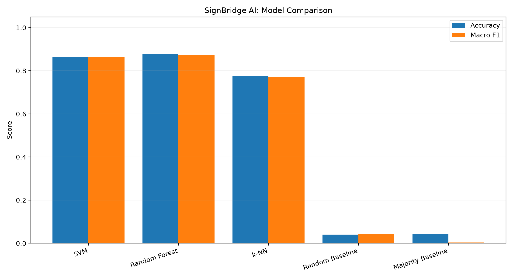
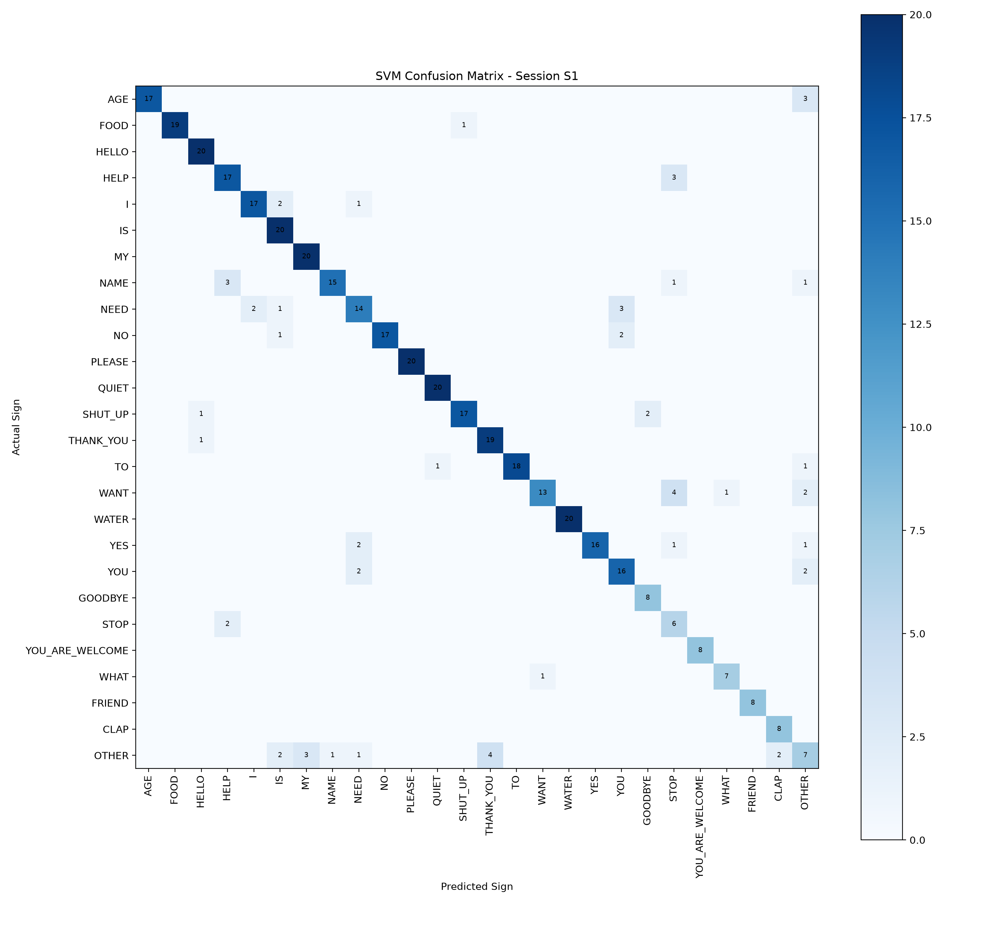
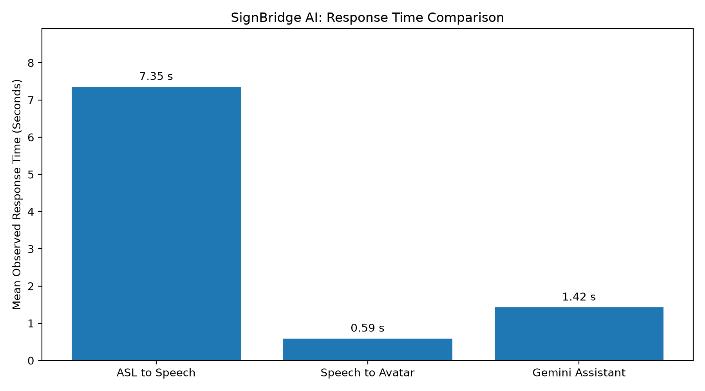

# SignBridge AI
### An AI-Powered Bidirectional Sign Language Communication System with a 3D Animated Avatar and Intelligent Assistant

**FAST National University of Computer and Emerging Sciences — Karachi Campus**  
**Course:** Artificial Intelligence Laboratory (Fall 2026)  
**Project Type:** Semester Lab Project

## 1. Project Overview

SignBridge AI is a web-based communication prototype designed to support interaction between American Sign Language (ASL) users and individuals who communicate through spoken or written English.

The application combines computer vision, machine learning, speech processing, a 3D animated avatar, and Google Gemini to provide three interconnected communication capabilities:

1. **ASL to Text and Speech:** Recognizes supported hand signs through a webcam and converts them into English text and spoken audio.
2. **Speech/Text to ASL:** Maps supported English words and expressions to gesture animations performed by a 3D human avatar.
3. **AI Assistant:** Provides conversational responses through Google Gemini, with text and speech output.

The system focuses on a limited vocabulary of supported signs rather than attempting unrestricted, grammatically complete ASL translation.

## 2. Key Features

### ASL Recognition and Speech Generation

- Live webcam-based recognition using MediaPipe Hands.
- Recognition of 25 word-level signs.
- Fingerspelling support for 26 alphabet letters.
- Recognition of digits 0–9.
- Automatic switching to alphabet or number recognition in supported contexts.
- Sentence formation from recognized gestures.
- Text-to-speech output for completed sentences.
- Confidence-based prediction filtering and repeated-sign confirmation.
- Automatic and precise sign-recognition workflows.

### Speech and Text to ASL Avatar

- Speech-to-text processing for spoken English input.
- Support for typed English input.
- Animated 3D human avatar.
- Mapping of supported words and expressions to avatar gestures.
- Browser-based avatar rendering and animation.
- Support for fingerspelling animations where implemented.

The avatar uses animated 3D gestures rather than relying on prerecorded videos as its primary translation mechanism.

### Gemini AI Assistant

- Conversational text generation using Google Gemini.
- Text-based interaction.
- Speech output for assistant responses.
- Integration with the application's communication workflows.

Gemini requires an internet connection and a valid API key. Local sign recognition and trained-model inference do not require Gemini.

## 3. Supported Vocabulary

The word-level recognition model supports the following 25 signs:

`AGE`, `FOOD`, `HELLO`, `HELP`, `I`, `IS`, `MY`, `NAME`, `NEED`, `NO`, `PLEASE`, `QUIET`, `SHUT_UP`, `THANK_YOU`, `TO`, `WANT`, `WATER`, `YES`, `YOU`, `GOODBYE`, `STOP`, `YOU_ARE_WELCOME`, `WHAT`, `FRIEND`, `CLAP`.

Additional recognition capabilities include:

- **Alphabet:** A–Z (26 letters)
- **Numbers:** 0–9 (10 digits)

Together, these provide **61 supported recognition labels** across the word, alphabet, and number systems, excluding the word model's `OTHER` rejection class.

Recognition accuracy varies across signs, lighting conditions, signing styles, and camera viewpoints.

## 4. System Architecture

### ASL to Speech

```text
Webcam
   |
   v
OpenCV + MediaPipe Hands
   |
   v
Hand Landmark Extraction
   |
   v
Temporal Feature Processing
   |
   v
Trained SVM Classifier
   |
   v
Prediction Filtering
   |
   v
Recognized Signs
   |
   v
Sentence Formation
   |
   v
English Text + Speech Output
```

### Speech/Text to ASL

```text
Microphone / Typed Text
          |
          v
   Speech Recognition
          |
          v
   English Text Input
          |
          v
   Supported Gesture Mapping
          |
          v
     3D Avatar Engine
          |
          v
   Animated ASL Gestures
```

### Gemini Assistant

```text
Text / Supported Communication Input
                  |
                  v
          Gemini AI Assistant
                  |
                  v
           Generated Response
                  |
           +------+------+
           |             |
           v             v
      Text Output    Speech Output
```

## 5. Technology Stack

| Component | Technology |
|---|---|
| Programming language | Python 3.11 |
| Web application | Streamlit |
| Webcam streaming | Streamlit-WebRTC |
| Computer vision | OpenCV |
| Hand landmark detection | MediaPipe Hands |
| Machine learning | scikit-learn |
| Primary classifier | Support Vector Machine (SVM) |
| Comparison models | Random Forest and k-Nearest Neighbors |
| Numerical processing | NumPy |
| Model serialization | Joblib |
| Evaluation and visualization | Matplotlib |
| AI assistant | Google Gemini |
| Text-to-speech | Python speech-processing tools |
| 3D avatar | Three.js-based browser animation system |
| Avatar development tools | JavaScript, Node.js, Vite |

## 6. Machine Learning Methodology

### Dataset Collection

A custom webcam-based dataset was collected for supported signs in multiple recording sessions.

MediaPipe extracts hand landmarks, which are normalized and converted into feature vectors. Temporal information is included to capture changes in hand position and movement during gestures.

For the word-level classifier:

- Sequence length: 24 frames
- Approximate sampling rate: 12 FPS
- Feature extraction: Hand landmarks, position, and motion information
- Primary classification algorithm: SVM with an RBF kernel

### Dataset and Evaluation Split

| Description | Value |
|---|---:|
| Total recorded sequences | 1,432 |
| Training samples | 984 |
| Testing samples | 448 |
| Classes evaluated | 26 (25 words + OTHER) |
| Training sessions | S2, S3 |
| Evaluation session | S1 |

Complete recording sessions were separated during evaluation to avoid mixing frames from the same sequence between training and testing.

### Classifier Comparison

Three machine learning algorithms were evaluated using the same training and testing split. Two baseline methods were also included.

| Model | Accuracy | Macro F1-score |
|---|---:|---:|
| **Random Forest** | **87.95%** | **0.875** |
| Support Vector Machine (SVM) | 86.38% | 0.864 |
| k-Nearest Neighbors (k-NN) | 77.68% | 0.773 |
| Random Baseline | 4.02% | 0.042 |
| Majority-Class Baseline | 4.46% | 0.003 |

Random Forest achieved the highest recorded evaluation accuracy, outperforming SVM by 1.57 percentage points.

**SVM was retained as the primary real-time recognition model** because its existing recognition pipeline had already been configured, integrated, and tested within the application.

The comparison evaluates the word-level classifier, not the separate alphabet and digit recognition models.

### Model Comparison Graph



### SVM Confusion Matrix



The confusion matrix shows that performance varies across classes. Some visually similar signs, including HELP and STOP, remain challenging to distinguish consistently.

### Evaluation Limitations

Although S1 recordings were excluded from model training, S1 results were used repeatedly during development to guide improvements. Therefore, these results should be interpreted as development-stage held-out-session results rather than performance on a completely untouched final test set.

A separate unseen-signer evaluation has not been established.

## 7. Response-Time Evaluation

The three principal communication workflows were tested through manually timed trials.

| Module | Average Response Time |
|---|---:|
| ASL to Speech | 7.352 seconds |
| Speech to 3D Avatar | 0.587 seconds |
| Gemini Assistant | 1.425 seconds |



Each workflow was measured over three trials. Measurements include interaction and manual timing delays and should be treated as approximate end-to-end response times.

ASL-to-Speech currently has the highest delay. This is an area for future optimization, particularly gesture confirmation, sentence completion, and streaming responsiveness.

## 8. Project Structure

```text
SignBridge-AI/
|
|-- app.py
|-- recognition/
|-- assistant/
|-- speech/
|-- avatar-engine/
|   |-- src/
|   |-- public/
|   |-- package.json
|   |-- package-lock.json
|
|-- models/
|   |-- sequence_extended_v1.joblib
|   |-- alnum_alphabet_v1.joblib
|   |-- alnum_numbers_v1.joblib
|   |-- alphabet_uv_specialist_v1.joblib
|
|-- assets/
|-- evaluation/
|   |-- 01_model_comparison.png
|   |-- 02_svm_confusion_matrix.png
|   |-- 03_response_time.png
|   |-- model_comparison.csv
|   |-- latency_results.csv
|   |-- svm_classification_report.txt
|
|-- sequence_extended.py
|-- evaluate_models.py
|-- measure_latency.py
|-- requirements.txt
|-- run_signbridge.bat
|-- README.md
```

The repository includes additional training, testing, and development scripts. Raw recording datasets and local environments may be maintained separately from the public repository.

## 9. Installation and Setup

Follow the instructions below to install and run SignBridge AI on a Windows computer. The application has been tested using Python 3.11 and the dependency versions specified in `requirements.txt`.

### System Requirements

- Windows 10 or Windows 11
- Python 3.11
- Git
- Webcam and microphone
- Google Chrome or another compatible browser
- Internet connection and Gemini API key (for the AI Assistant only)
- Node.js and npm (optional, for 3D avatar frontend development)

### Step 1 — Clone the GitHub Repository

Open PowerShell in the folder where you want to download the project.

```powershell
git clone https://github.com/K242032-FatimaJavaid/SignBridge-AI.git
```

Navigate into the cloned project directory:

```powershell
cd SignBridge-AI
```

### Step 2 — Create a Python Virtual Environment

Create a virtual environment using Python 3.11:

```powershell
py -3.11 -m venv .venv
```

The `.venv` folder will contain the project's isolated Python environment.

**Note:** Activating the virtual environment is optional because the commands below directly use its Python executable.

If you prefer to activate it, run:

```powershell
.\.venv\Scripts\Activate.ps1
```

If PowerShell blocks activation, run:

```powershell
Set-ExecutionPolicy -Scope Process Bypass
```

Then retry activation.

### Step 3 — Install Required Dependencies

Install the tested Python dependencies using:

```powershell
.\.venv\Scripts\python.exe -m pip install -r requirements.txt
```

The `requirements.txt` file contains compatible versions of Streamlit, MediaPipe, OpenCV, NumPy, Scikit-learn, Streamlit-WebRTC, Google GenAI, and other required packages.

After installation, verify dependency compatibility:

```powershell
.\.venv\Scripts\python.exe -m pip check
```

Expected output:

```text
No broken requirements found.
```

If dependency conflicts appear, review the installation errors before launching the application.

### Step 4 — Configure the Gemini AI Assistant (Optional)

SignBridge AI's core sign recognition and speech translation features work without Gemini.

To enable the Gemini AI Assistant, obtain a valid Gemini API key from Google AI Studio.

In the project's root directory, create the Streamlit configuration folder:

```powershell
New-Item -ItemType Directory -Force ".streamlit"
```

Create or open the secrets file:

```powershell
notepad ".streamlit\secrets.toml"
```

Add the following configuration:

```toml
GEMINI_API_KEY = "YOUR_GEMINI_API_KEY"
GEMINI_MODEL = "gemini-2.5-flash"
```

Replace `YOUR_GEMINI_API_KEY` with your personal API key. The model name may be adjusted to a supported Gemini model.

Save the file and restart Streamlit if it is already running.

**Security:** Never upload your actual API key to GitHub. The `.streamlit/secrets.toml` file is excluded through `.gitignore`.

Alternatively, Gemini credentials can be supplied using environment variables when no Streamlit secrets file is present.

If no Gemini key is configured, the AI Assistant will remain unavailable, while the other communication features can still operate.

### Step 5 — Launch SignBridge AI

From the project root, start the Streamlit application:

```powershell
.\.venv\Scripts\python.exe -m streamlit run app.py --server.address 127.0.0.1
```

Open the application in your browser:

```text
http://127.0.0.1:8501
```

Allow camera and microphone permissions when prompted.

If port `8501` is already occupied, use another port:

```powershell
.\.venv\Scripts\python.exe -m streamlit run app.py --server.address 127.0.0.1 --server.port 8502
```

Then open:

```text
http://127.0.0.1:8502
```

### Step 6 — Verify Application Functionality

After launching the application, verify the following features:

1. **ASL to Speech:** Start the webcam, perform supported ASL gestures, and verify that the corresponding predictions appear.
2. **Sentence Formation:** Perform multiple supported signs and verify the generated sentence.
3. **Text-to-Speech:** Verify that recognized text can be spoken aloud.
4. **Speech to ASL:** Provide speech input and verify that the corresponding sign language videos or gestures are displayed.
5. **Gemini AI Assistant:** If configured, enter a question and verify that the assistant generates a response.

A working microphone and webcam, along with appropriate browser permissions, are required for the corresponding features.

### Troubleshooting

**Python 3.11 is not found**

Install Python 3.11 and ensure it is available through the Windows Python Launcher (`py`).

**Missing Python module**

Ensure that dependencies were installed inside the project's virtual environment:

```powershell
.\.venv\Scripts\python.exe -m pip install -r requirements.txt
```

**Dependency compatibility errors**

Run:

```powershell
.\.venv\Scripts\python.exe -m pip check
```

Use the pinned requirements instead of independently upgrading individual libraries.

**Gemini API key not found**

Create `.streamlit/secrets.toml` and configure your personal API key as described in Step 4.

**Camera or microphone not working**

Verify device permissions in Windows and your browser. Make sure another application is not exclusively using the device.

**Streamlit port already in use**

Launch the application on another port, such as `8502` or `8503`.

### Optional — 3D Avatar Development

The Three.js avatar source code is located in `avatar-engine/`. Developers who want to run or modify that frontend separately can use Node.js and npm.

From the project root:

```powershell
cd avatar-engine
npm install
npm run dev
```

The development server will display its local address in the terminal.

Return to the main project directory before launching SignBridge AI's Streamlit application.

## 10. Using the Application

### ASL to Speech

1. Launch SignBridge AI.
2. Open the ASL recognition interface.
3. Select the webcam and start recognition.
4. Perform a supported sign in front of the camera.
5. Review recognized words in the sentence panel.
6. Complete the sentence to generate spoken output.

The system also supports alphabet and digit recognition for supported fingerspelling and number-entry contexts.

### Speech to ASL

1. Open the speech-to-ASL interface.
2. Provide spoken or typed English.
3. Submit the expression.
4. View supported gestures through the animated 3D avatar.

Only expressions supported by the avatar's gesture library can be animated correctly.

### Gemini Assistant

1. Open the AI assistant.
2. Enter a message using the available supported input method.
3. Submit the message.
4. Read or listen to the generated response.

Gemini responses require an active internet connection.

## 11. Challenges and Limitations

The current prototype has several limitations:

- Confusion between visually similar hand signs.
- Sensitivity to signing speed, hand position, and camera viewpoint.
- Variation in recognition performance across different vocabulary classes.
- Increased ASL-to-Speech response time due to sequence processing and sentence confirmation.
- Limited support for full ASL grammar and nonmanual expressions.
- Avatar animation limited to supported gestures.
- Internet dependency for Gemini responses.
- Limited evaluation across independent signers and environments.

SignBridge AI is an academic prototype and should not be treated as a certified sign-language interpreting system.

## 12. Future Improvements

Potential future improvements include:

- Reducing webcam streaming and end-to-end recognition latency.
- Increasing dataset diversity across multiple signers.
- Evaluating models on a completely independent recording session.
- Improving recognition of similar gestures.
- Expanding supported vocabulary after validating existing signs.
- Improving sentence handling and contextual interpretation.
- Expanding the 3D avatar gesture library.
- Improving support for continuous communication.
- Strengthening offline assistance and application robustness.

## 13. Project Team

| Team Member | Roll Number | Contribution |
|---|---|---|
| **Fatima Javaid (Team Leader)** | 24K-2032 | Project coordination, dataset collection, ASL recognition, model training and evaluation, sign-to-speech |
| **Sidratun Muntaha** | 24K-2007 | 3D avatar, gesture animation, phrase mapping and avatar integration |
| **Abeeha Shaikh** | 24K-2031 | AI assistant, speech processing, application interface, backend and integration |

## 14. Academic Information

**Institution:** FAST National University of Computer and Emerging Sciences, Karachi Campus  
**Course:** Artificial Intelligence Laboratory (Fall 2026)  
**Project:** SignBridge AI — An AI-Powered Bidirectional Sign Language Communication System with a 3D Animated Avatar and Intelligent Assistant

---

**SignBridge AI — Bridging Communication Through Artificial Intelligence.**
