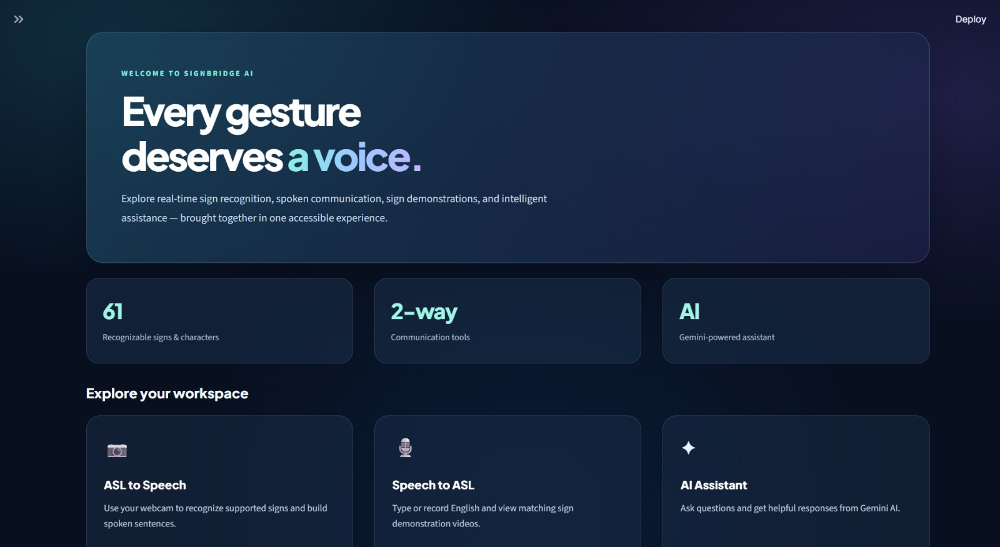
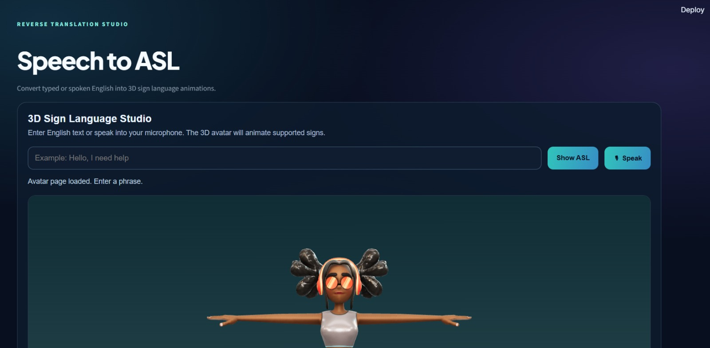
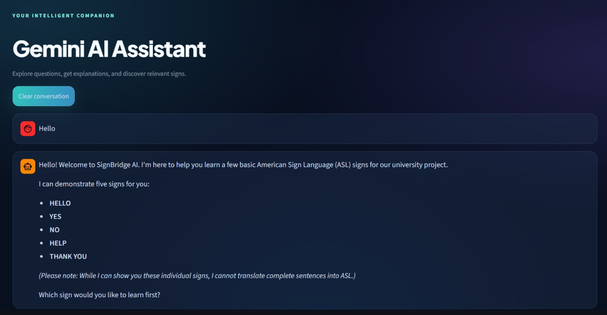

# SignBridge AI — Project Report

**AI-Powered Bidirectional Sign Language Communication Application**

SignBridge AI is an academic AI laboratory project developed at FAST — National University of Computer and Emerging Sciences, Karachi Campus. The application demonstrates how computer vision, supervised machine learning, speech processing, 3D gesture animation, and conversational AI can be combined to support communication between American Sign Language (ASL) users and people who communicate through spoken or written English.

> **Project status:** Implemented academic prototype. The capabilities and evaluation figures below are reported in the team's Fall 2026 project report. The system is a limited-vocabulary demonstration, not a complete ASL translator or a replacement for a qualified interpreter.

## Project Information

| Item | Details |
|---|---|
| University | FAST — National University of Computer and Emerging Sciences, Karachi Campus |
| Department | FAST School of Computing — Department of Artificial Intelligence & Data Science |
| Course | AL-2002 — Artificial Intelligence (Laboratory) |
| Programme | BS Cyber Security |
| Semester | 5th Semester |
| Section | BCY-5A |
| Session | Fall 2026 |
| Project | SignBridge AI |
| Project category | Applied / Data |
| Submission date in report | 23 November 2026 |
| GitHub repository | [K242032-FatimaJavaid/SignBridge-AI](https://github.com/K242032-FatimaJavaid/SignBridge-AI) |

### Team

| Team member | Roll number | Main contribution |
|---|---:|---|
| Fatima Javaid — Team Leader | 24K-2032 | Dataset collection, ASL recognition, machine-learning training and evaluation, integration, testing, and project coordination |
| Sidratun Muntaha | 24K-2007 | 3D avatar, gesture animations, gesture mapping, and avatar integration |
| Abeeha Shaikh | 24K-2031 | Streamlit interface, Gemini assistant, speech processing, and collaborative dataset recording |

All three team members participated in recording the sign-language dataset. The application was assembled through integration of the separately developed modules, with Fatima coordinating final application assembly and the GitHub submission.

## 1. Project Overview

The application combines three communication components in a unified Streamlit interface:

1. **ASL-to-Speech Recognition:** Captures hand gestures through a webcam, extracts hand landmarks, predicts supported signs, builds recognized text, and produces spoken output.
2. **English-to-ASL Avatar:** Accepts typed or spoken English and displays corresponding supported gestures through a browser-based 3D avatar.
3. **Gemini AI Assistant:** Provides conversational responses through the Google Gemini service.

The recognition system supports **25 word-level signs, 26 alphabet characters, and 10 digits** across its recognition features. This represents 61 supported labels across the main recognition systems. The separate word-level model evaluation uses 25 word signs plus an `OTHER` class, for 26 evaluated classes.

## 2. Problem Statement

Communication between sign-language users and people who do not understand sign language can be difficult when an interpreter is unavailable. Automatic gesture recognition is challenging because hand shape, finger position, movement, orientation, timing, lighting, and camera conditions can vary.

SignBridge AI addresses this problem by treating supported sign recognition as a supervised multiclass classification task. It extracts hand landmarks from webcam frames, derives temporal features, and passes those features to a trained classifier. A confirmation mechanism checks prediction stability before adding a recognized sign to the sentence.

The application also supports reverse communication through a 3D avatar and conversational interaction through the Gemini assistant.

## 3. Main Features

- Webcam-based recognition of supported ASL word signs.
- Alphabet-character and digit recognition.
- Sentence construction from recognized sign sequences.
- Text-to-speech output for recognized sentences.
- Typed and spoken English input for supported avatar gestures.
- Browser-based 3D avatar with mapped gesture animations.
- Gemini-powered conversational assistant.
- Prediction confidence and stability checks.
- Rejection of uncertain or unsupported predictions.
- Evaluation of multiple machine-learning classifiers and baseline methods.

## 4. System Architecture

The application is organized into three main workflows.

### 4.1 ASL-to-Speech Workflow

1. Capture video frames from the webcam.
2. Detect hands and extract landmarks using MediaPipe Hands.
3. Normalize and transform landmark observations into temporal features.
4. Pass the feature vector to the trained classifier.
5. Rank predicted classes using their estimated probabilities.
6. Apply confidence, margin, and temporal confirmation checks.
7. Add confirmed signs to the sentence.
8. Generate spoken output when the sentence is completed.

The confirmation logic helps avoid unstable predictions, repeated insertion of a gesture that is being held, and acceptance of uncertain signs.

### 4.2 English-to-ASL Avatar Workflow

1. Receive typed or spoken English input.
2. Convert spoken input to text where required.
3. Identify supported words or expressions.
4. Map supported content to available gesture animations.
5. Send the animation sequence to the avatar engine.
6. Display the corresponding movement through the 3D avatar.

Avatar output is restricted to the available gesture library. It does not perform unrestricted grammatical translation into ASL.

### 4.3 Gemini Assistant Workflow

1. Receive the user's conversational input.
2. Send the request to the Gemini integration.
3. Display the generated assistant response.
4. Use the application's speech functionality where supported.

Gemini is an external online service and requires an appropriately configured API key and internet access.

## 5. Technologies Used

| Technology | Role in the application |
|---|---|
| Python 3.11 | Main application and AI implementation |
| Streamlit | Main application interface |
| OpenCV | Webcam and video-frame processing |
| MediaPipe Hands | Hand detection and landmark extraction |
| NumPy | Numerical feature processing |
| scikit-learn | SVM, Random Forest, and k-NN classifiers |
| Joblib | Saving and loading trained models |
| Speech utilities | Speech input and spoken output |
| Google Gemini API | Conversational assistant |
| JavaScript / Three.js | Browser-based 3D avatar engine |
| Node.js and npm | Avatar frontend development and setup |

## 6. Machine-Learning Approach

### 6.1 Feature Extraction

MediaPipe Hands extracts hand landmarks from webcam frames. The recognition pipeline processes a sliding window of landmark observations and converts it into temporal features.

The report describes the following processing sequence:

- Convert the observation window into a numerical array.
- Apply the project's temporal feature transformation.
- Obtain class probabilities from the trained model.
- Identify the highest- and second-highest-ranked classes.
- Calculate prediction confidence and the margin between the top two predictions.
- Confirm a sign across observations before accepting it.

This approach uses structured landmark features rather than training directly on raw video frames.

### 6.2 Classifiers Compared

| Model | Description | Evaluated accuracy | Macro F1-score |
|---|---|---:|---:|
| Random Forest | Ensemble of decision trees | **87.95%** | **0.875** |
| Support Vector Machine (SVM) | RBF-kernel supervised classifier | 86.38% | 0.864 |
| k-Nearest Neighbors (k-NN) | Distance-based supervised classifier | 77.68% | 0.773 |

### 6.3 Baselines

Two baseline approaches were included for comparison:

- **Uniform random baseline:** predicts a class randomly.
- **Majority-class baseline:** always predicts the most frequent class.

| Baseline | Accuracy | Macro F1-score |
|---|---:|---:|
| Uniform Random | 4.02% | 0.042 |
| Majority Class | 4.46% | 0.003 |

Random Forest achieved the highest measured evaluation accuracy. However, **SVM is the classifier integrated into the real-time recognition application**, because the existing recognition pipeline had already been configured and tested around it.

## 7. Dataset and Experimental Setup

### 7.1 Dataset

| Item | Reported details |
|---|---|
| Dataset name | SignBridge AI Self-Collected ASL Gesture Dataset |
| Collection method | Webcam recordings collected by the project team |
| Total evaluated word-level sequences | 1,432 |
| Word-level classes | 25 supported word signs plus `OTHER` |
| Features | MediaPipe hand landmarks and temporally derived motion features |
| Preprocessing | Landmark extraction, normalization, and temporal feature transformation |
| Model storage | Trained models saved as `.joblib` files |
| Raw recordings | Maintained separately; not included as public repository data in the report |

The dataset was recorded collaboratively by Fatima Javaid, Abeeha Shaikh, and Sidratun Muntaha across multiple recording sessions.

### 7.2 Evaluation Split

| Item | Configuration |
|---|---|
| Training set | 984 sequences from sessions S2 and S3 |
| Test set | 448 sequences from session S1 |
| Number of evaluated classes | 26 |
| Evaluation strategy | Held-out recording-session comparison |
| Compared methods | SVM, Random Forest, k-NN, uniform random, and majority-class baseline |
| Metrics | Accuracy, macro F1-score, confusion matrix, and response time |
| Timing trials | Three per application module |
| Development environment | Windows 11 laptop, Python 3.11 |
| Evaluation script | `evaluate_models.py` |

The held-out session split helps separate the training recordings from the test recordings. However, it is still a development-stage evaluation and does not establish performance across all ASL users or unseen populations.

## 8. Experimental Results

### 8.1 Classifier Comparison

Random Forest achieved the highest recorded accuracy at 87.95%, followed by SVM at 86.38% and k-NN at 77.68%. All three trained classifiers performed substantially better than the two baseline methods on the reported evaluation split.

SVM remained the deployed model because it was already integrated into the real-time recognition workflow. The small difference between Random Forest and SVM should be interpreted cautiously; further evaluation on more independent signers and untouched test data is needed.

### 8.2 Response-Time Measurements

The report records three timing trials for each application module.

| Module | Trial 1 | Trial 2 | Trial 3 | Reported mean |
|---|---:|---:|---:|---:|
| ASL to Speech | 5.619 s | 6.690 s | 9.746 s | **7.352 s** |
| Speech to 3D Avatar | 0.843 s | 0.571 s | 0.348 s | **0.587 s** |
| Gemini Assistant | 1.770 s | 1.347 s | 1.157 s | **1.425 s** |

The ASL-to-Speech workflow had the longest measured response time because it includes webcam observation, temporal classification, prediction confirmation, and sentence completion. The reported measurements are based on three trials per module and should not be treated as universal performance guarantees.

### 8.3 Visualizations Included in the Report

The project report includes:

- Classifier accuracy and macro F1-score comparison.
- SVM confusion matrix.
- Application-module response-time comparison.
- Screenshots of the main application and its communication interfaces.

Evaluation output files listed in the report:

```text
evaluation/
├── model_comparison.csv
├── svm_classification_report.txt
├── latency_results.csv
├── 01_model_comparison.png
├── 02_svm_confusion_matrix.png
└── 03_response_time.png
```
#### Figure 1 — Model Comparison


#### Figure 2 — SVM Confusion Matrix


#### Figure 3 — Response Time Analysis


### 8.4 Application Screenshots

#### Figure 4 — SignBridge AI Home Page


#### Figure 5 — ASL to Speech Module


#### Figure 6 — Speech to ASL / Application Screenshot


#### Figure 7 — Gemini / Application Screenshot


## 9. Implementation Structure

The report identifies the following main application files and components:

| File / folder | Responsibility |
|---|---|
| `app.py` | Main Streamlit application, navigation, and interface |
| `recognition/webcam_streamlit.py` | Live webcam recognition, sentence building, and speech coordination |
| `recognition/sequence_realtime.py` | Temporal gesture analysis and recognition confirmation |
| `recognition/sequence_precision.py` | Controlled sequence recognition |
| `recognition/alnum_streamlit.py` | Alphabet and digit recognition |
| `sequence_extended.py` | Gesture feature processing and model-related utilities |
| `evaluate_models.py` | Classifier comparison and evaluation |
| `measure_latency.py` | Response-time measurement and visualization |
| `assistant/` | Gemini integration and conversational assistant logic |
| `speech/` | Speech input and output utilities |
| `avatar-engine/` | 3D avatar, gesture mapping, and animation system |

### 9.1 Object-Oriented Design

The report describes these OOP concepts in the recognition implementation:

- **Encapsulation:** `SequenceRecognizer` maintains its prediction window, evidence, timing, and recognition state.
- **Inheritance:** `SignVideoProcessor` extends `VideoProcessorBase`; the precision recognizer extends the base sequence recognizer.
- **Method overriding:** `recv()` and `update()` provide specialized behavior in derived classes.
- **Polymorphism:** Recognition implementations expose a common `update()` interface while supporting different recognition behavior.

## 10. Testing

The project report records the following test cases as passed:

| Test case | Expected behavior | Reported observation |
|---|---|---|
| Supported ASL signs | Correct words appear in the recognition interface | Recognition and sentence formation demonstrated |
| Automatic sentence completion | Sentence finishes after signing ends | Completion behavior adjusted and reported working |
| Speech generation | Recognized sentence is spoken | Speech startup optimized and tested |
| Speech/Text to Avatar | Supported phrase triggers a matching animation | 3D avatar interface implemented and demonstrated |
| Gemini assistant | User receives a conversational response | Assistant response demonstrated in the application |

### Exception Handling

| Condition | Reported handling |
|---|---|
| Missing model file | Recognition does not start and the missing model is reported |
| Gemini request exception | Original text may be retained or an error displayed, depending on the workflow |
| Speech engine failure | Error is logged without terminating the entire application |
| Low-confidence gesture | Prediction is rejected or marked uncertain |

## 11. Limitations and Ethical Considerations

- The recognition system supports a limited vocabulary and may misclassify visually similar gestures.
- Recognition can be affected by lighting, hand occlusion, camera angle, movement speed, and differences between signers.
- The collected dataset may not represent the full diversity of ASL users.
- The avatar uses a constrained gesture library and does not model complete ASL grammar, facial expressions, or all nonmanual features.
- Word-by-word or limited-expression animation should not be interpreted as unrestricted ASL translation.
- Gemini requires an internet connection and sends requests to an external service. Users should avoid entering sensitive information.
- Personal recordings should only be shared publicly with appropriate permission.
- The prototype is intended for academic demonstration and is not a substitute for a qualified human sign-language interpreter.

## 12. Challenges and Lessons Learned

### Recognition responsiveness

The initial recognition workflow required sustained observation and repeated confirmation before accepting signs. Increasing processing frequency caused webcam lag, while reducing confirmation too aggressively could increase incorrect predictions. The team adjusted confirmation settings, streaming behavior, sentence-completion timing, and speech initialization to improve usability.

### Integration of multiple technologies

The project combined Python-based machine learning, Streamlit, speech processing, a JavaScript 3D avatar, and Gemini services. Integration required consistent input handling, application-state management, and coordination between independent modules. The final application brings these components together while retaining separate modules for maintenance and testing.

## 13. Conclusion and Future Work

SignBridge AI demonstrates an integrated prototype for AI-assisted communication using webcam sign recognition, speech output, animated 3D gestures, and a conversational assistant. It supports a constrained set of word-level signs, alphabet characters, and digits within a unified Streamlit application.

In the reported experiment, Random Forest achieved the highest measured classification accuracy, while SVM remained the model used by the real-time recognition application. The response-time results also showed that temporal observation and confirmation contribute to the delay in ASL-to-Speech interaction.

Future work should focus on:

- Collecting recordings from more independent signers.
- Evaluating the system on participants excluded from training.
- Expanding the supported sign vocabulary.
- Improving avatar gesture coverage and linguistic accuracy.
- Reducing recognition latency while preserving prediction reliability.
- Improving robustness under different lighting, camera, and signing conditions.

## 14. Setup and Execution

### Requirements

- Windows 10 or Windows 11.
- Python 3.11.
- Webcam and microphone.
- Google Chrome or another compatible browser.
- Internet connection and a Gemini API key for online assistant functionality.
- Node.js and npm if the 3D avatar frontend needs to be developed or rebuilt.

### Step 1 — Clone the repository

```bash
git clone https://github.com/K242032-FatimaJavaid/SignBridge-AI.git
cd SignBridge-AI
```

### Step 2 — Create a virtual environment

```bash
python -m venv .venv
```

Activate it in PowerShell:

```powershell
.\.venv\Scripts\Activate.ps1
```

If PowerShell blocks activation, run:

```powershell
Set-ExecutionPolicy -Scope Process Bypass
```

Then activate the environment again.

### Step 3 — Install Python dependencies

```bash
python -m pip install -r requirements.txt
```

### Step 4 — Configure Gemini

Configure a valid Gemini API key using the assistant's expected local configuration method.

**Security note:** Do not place real API keys in source code or commit local credentials to GitHub. The core webcam recognition system can operate separately from Gemini.

### Step 5 — Run the application

From the project root:

```bash
python -m streamlit run app.py --server.address 127.0.0.1
```

Open the following address in your browser:

```text
http://127.0.0.1:8501
```

Grant camera and microphone permissions when prompted.

### Optional — Run the avatar development frontend

The Three.js avatar source is stored in `avatar-engine/`. If the frontend needs to be run or rebuilt separately:

```bash
cd avatar-engine
npm install
npm run dev
```

Use the local address displayed by the development server. Return to the project root before launching the Streamlit application.

## 15. References and Acknowledgments

- [MediaPipe Hands](https://ai.google.dev/edge/mediapipe)
- [OpenCV](https://opencv.org/)
- [scikit-learn](https://scikit-learn.org/)
- [Streamlit](https://streamlit.io/)
- [Three.js](https://threejs.org/)
- [Google Gemini API](https://ai.google.dev/)
- Python and NumPy documentation

Established open-source libraries and acknowledged AI-assisted development tools were used during prototyping, debugging, and documentation. The project team is responsible for understanding, explaining, and validating the submitted implementation.

---

**Course:** AL-2002 — Artificial Intelligence Laboratory  
**Project:** SignBridge AI  
**Session:** Fall 2026  
**Repository:** [https://github.com/K242032-FatimaJavaid/SignBridge-AI](https://github.com/K242032-FatimaJavaid/SignBridge-AI)
