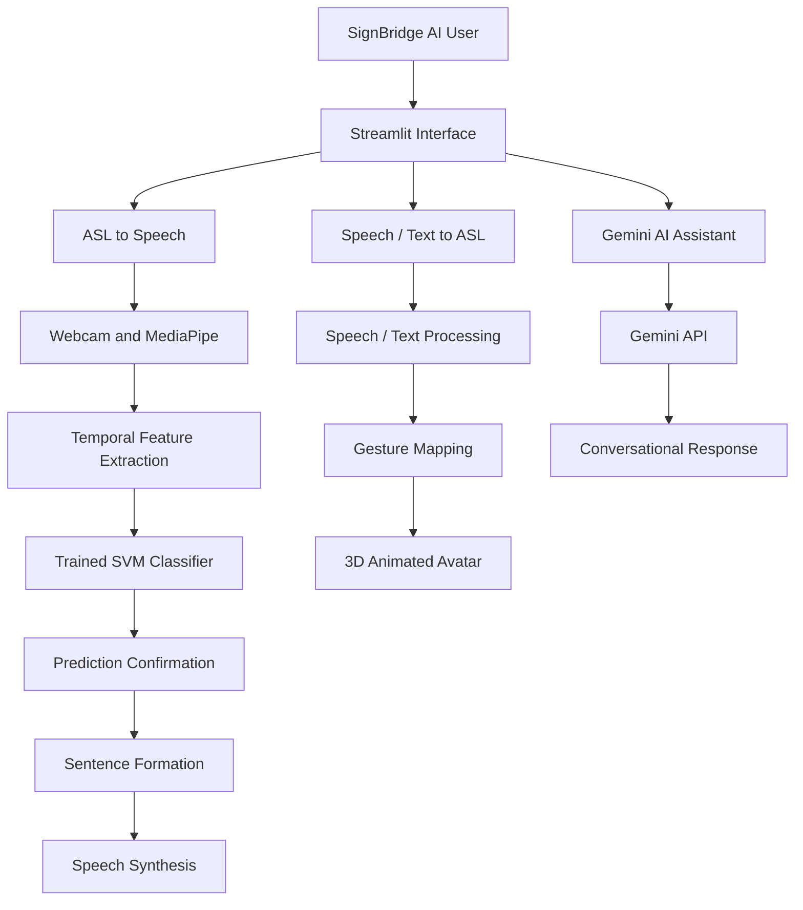
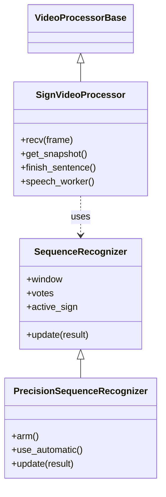
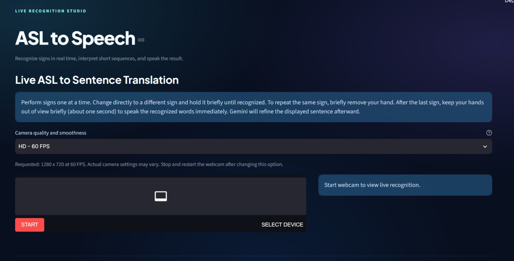
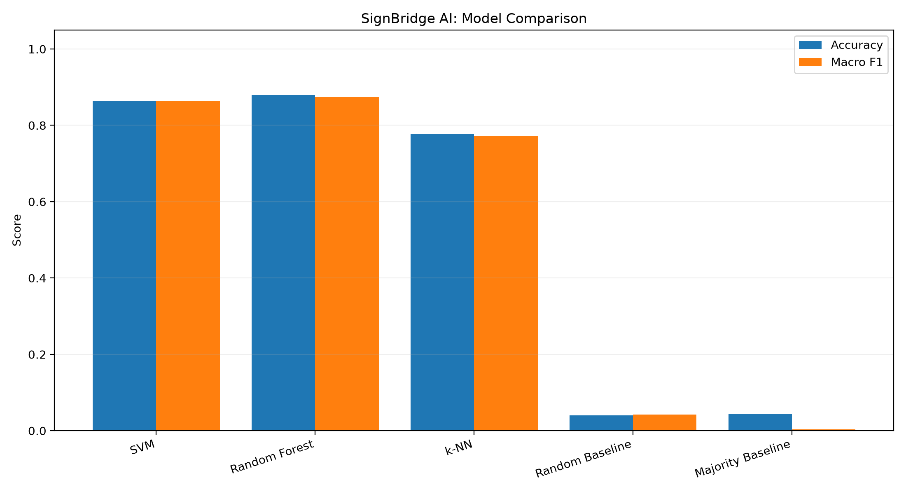
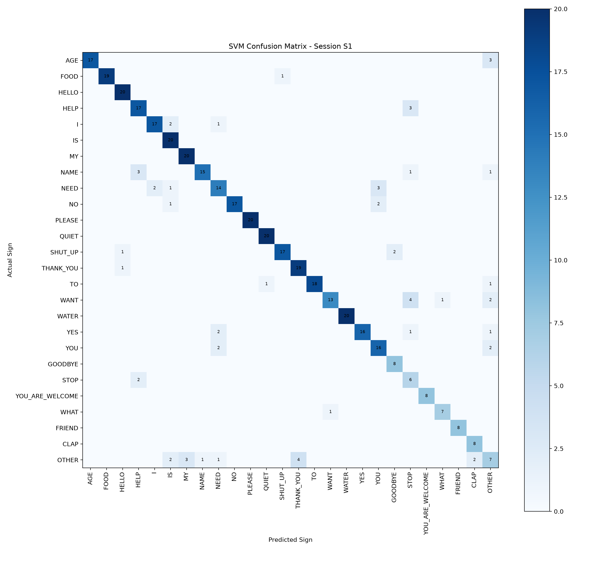
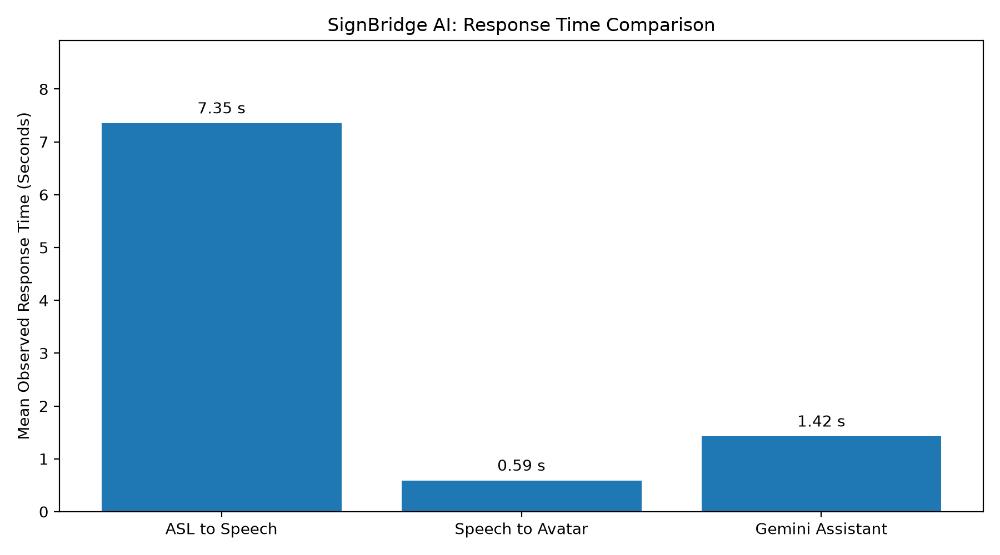

# SignBridge AI
## AI-Powered Bidirectional Sign Language Communication System

**FAST — National University of Computer and Emerging Sciences**  
FAST School of Computing — Karachi Campus  
Department of Artificial Intelligence & Data Science

**Course:** AL-2002 — Artificial Intelligence Laboratory  
**Programme / Semester:** BS Cyber Security — 5th Semester  
**Section:** BCY-5A  
**Session:** Fall 2026  
**Project Category:** Part B — Applied / Data  
**Project Idea:** Instructor-approved own idea  
**Date of Submission:** 23 November 2026

**GitHub Repository:** [SignBridge AI](https://github.com/K242032-FatimaJavaid/SignBridge-AI)

### Project Team

| Role | Student Name | Roll Number | Section |
|---|---|---|---|
| Team Leader | Fatima Javaid | 24K-2032 | BCY-5A |
| Member | Sidratun Muntaha | 24K-2007 | BCY-5A |
| Member | Abeeha Shaikh | 24K-2031 | BCY-5A |

---

# Table of Contents

- [Declaration and Contribution Statement](#declaration-and-contribution-statement)
- [1. Introduction](#1-introduction)
- [2. Problem Formulation](#2-problem-formulation)
- [3. System Design and Architecture](#3-system-design-and-architecture)
- [4. AI Techniques and Implementation](#4-ai-techniques-and-implementation)
- [5. Data and Experimental Setup](#5-data-and-experimental-setup)
- [6. Results and Analysis](#6-results-and-analysis)
- [7. Testing, Limitations and Ethics](#7-testing-limitations-and-ethics)
- [8. Individual Contributions and Conclusion](#8-individual-contributions-and-conclusion)
- [Appendix A — Setup and Execution](#appendix-a--setup-and-execution)
- [References and Acknowledgments](#references-and-acknowledgments)

---

# Declaration and Contribution Statement

We declare that SignBridge AI is a collaborative academic project developed by our three-member team with the instructor's approval. The project incorporates our implementation work, established open-source libraries, and acknowledged AI-assisted development tools.

All three team members participated in collecting and recording the sign-language dataset. The project components were developed through a division of responsibilities and subsequently integrated into a unified application.

Each member is responsible for understanding and explaining their assigned contributions.

| Member | Roll Number | Principal Contribution | Share | Signature |
|---|---|---|---|---|
| **Fatima Javaid** | 24K-2032 | ASL dataset recording, recognition system development, model training, performance optimization, integration, testing, and project coordination | **33.34%** | __________ |
| **Abeeha Shaikh** | 24K-2031 | Streamlit UI design, Gemini AI assistant, speech processing, response-time evaluation, and collaborative dataset recording | **33.33%** | __________ |
| **Sidratun Muntaha** | 24K-2007 | 3D avatar development, gesture animations, gesture mapping, classifier-comparison work, and collaborative dataset recording | **33.33%** | __________ |
| **Total** | | | **100%** | |

As team leader, Fatima coordinated the final application assembly, integration, testing, and GitHub repository submission.

---

# 1. Introduction

## 1.1 Overview

SignBridge AI is an AI-powered communication application designed to support interaction between people who use American Sign Language (ASL) and people who communicate through spoken or written English. It combines computer vision, supervised machine learning, speech processing, a 3D animated avatar, and an intelligent assistant within a single Streamlit interface.

In the ASL-to-Speech module, a webcam captures a user's hand movements. MediaPipe extracts hand landmarks, and a trained classifier identifies supported signs. Recognized words are assembled into sentences and converted into spoken audio. The reverse communication module accepts typed or spoken English and displays corresponding supported gestures through a 3D avatar. An integrated Gemini assistant provides conversational responses.

The recognition system supports 25 word-level signs, 26 alphabet characters, and 10 digits, representing 61 supported recognition labels across its main recognition systems. The application was developed using Python, OpenCV, MediaPipe, scikit-learn, Streamlit, and JavaScript-based avatar technologies.

The primary aim is to demonstrate how multiple AI-driven communication tools can work together in a practical, user-friendly application.

## 1.2 Objectives and Scope

| # | Objective | Achieved? |
|---|---|---|
| 1 | Implement webcam-based recognition for 25 word-level ASL signs using a trained classifier | Yes |
| 2 | Recognize alphabet characters and digits, assemble sign sequences, and generate speech | Yes |
| 3 | Implement a 3D animated avatar for supported English-to-ASL communication | Yes |
| 4 | Compare three ML algorithms against baselines using accuracy, F1-score, a confusion matrix, and response-time measurements | Yes |

**Out of scope:** Complete ASL grammatical interpretation, unrestricted sign vocabulary, and professional-grade translation accuracy.

The prototype operates using a limited trained vocabulary and supported avatar animations. It is intended as an academic demonstration rather than a replacement for a professional interpreter.

---

# 2. Problem Formulation

## 2.1 Problem Statement

Communication between sign-language users and non-signers can be difficult when a human interpreter is unavailable. Automatically interpreting hand gestures is challenging because gestures vary in finger configuration, position, movement, timing, and orientation. Different gestures may look similar, while the same sign can be performed differently by different individuals.

SignBridge AI models gesture recognition as a supervised multiclass classification problem. Hand landmarks extracted from consecutive video frames are converted into temporal feature vectors. A trained model predicts the most likely sign, while a confirmation mechanism checks whether the prediction is sufficiently stable before adding it to a sentence.

For example, when a user performs the signs `I`, `NEED`, and `WATER`, the application should identify the sequence, form the corresponding text, and generate spoken output. The system must also avoid repeatedly recognizing a held gesture or ending sentences when hand tracking briefly fails.

The project additionally addresses reverse communication through an animated avatar and conversational interaction through Gemini.

## 2.2 PEAS Description and Environment

PEAS represents the Performance Measure, Environment, Actuators, and Sensors associated with an intelligent agent.

### PEAS Description

| Component | Description |
|---|---|
| Performance Measure | Recognition accuracy, macro F1-score, response time, correct sentence formation, stable predictions, and successful module operation |
| Environment | Real-world webcam interaction with varying lighting, hand movement, camera orientation, and user behavior |
| Actuators | Recognized text, sentence display, synthesized speech, 3D avatar gestures, and AI-generated responses |
| Sensors | Webcam, MediaPipe hand landmarks, microphone, and text-input interface |

### Environment Classification

| Property | Classification | Justification |
|---|---|---|
| Observability | Partially observable | Occluded fingers and out-of-frame hands may not be fully detected |
| Determinism | Stochastic | Visual observations and classification outputs are uncertain |
| Change over time | Dynamic | Hand positions and user input change continuously |
| State and actions | Continuous observations and discrete predicted labels | Hand landmarks have continuous coordinates, while predicted sign classes are discrete |
| Agents | Single recognition agent | One recognition pipeline selects the output class |
| Agent type | Learning-based agent | Predictions depend on a trained machine-learning classifier |

The environment is partially observable because the webcam may not capture every finger and hand position accurately. It is dynamic because the input changes continuously as the user performs gestures.

## 2.3 Problem Representation

| Element | Representation in the Project |
|---|---|
| State representation | A temporal sequence of normalized MediaPipe hand-landmark features |
| Actions / moves | Classify a gesture, reject an uncertain prediction, append a recognized word, or finish a sentence |
| Initial state | Webcam initialized, empty prediction window, and empty sentence |
| Goal or terminal test | Correctly identify a supported sign or finalize a recognized sentence |
| Cost, utility, fitness, or evaluation | Accuracy, macro F1-score, confusion matrix, recognition stability, and latency |

The classification goal is to assign the correct supported sign label to an observed feature sequence. In the complete application, this prediction is combined with temporal confirmation and sentence-building logic.

---

# 3. System Design and Architecture

## 3.1 Overall Architecture

SignBridge AI integrates three main components under a common Streamlit application. The ASL recognition component captures webcam frames, detects hand landmarks using MediaPipe, and extracts temporal features. These features are passed to a trained classifier. Prediction filtering reduces unstable detections, and confirmed signs are added to the sentence builder. Completed sequences are converted into speech through a local synthesis component.

The reverse communication component accepts English text or microphone input and passes supported expressions to a browser-based 3D avatar engine. The engine renders corresponding sign animations.

The Gemini assistant accepts conversational input and generates relevant textual responses through an external AI service. Dedicated Python modules manage recognition, speech, application state, and experimental evaluation, while JavaScript components implement the 3D avatar interface.

### Figure 3.1 — SignBridge AI System Architecture



**Figure 3.1 Interpretation:** The application contains three communication workflows. Each workflow receives input, processes it through its corresponding components, and presents output through the common user interface.

## 3.2 Class Design

The recognition implementation uses an object-oriented structure to manage webcam frames, temporal gesture information, and prediction confirmation.

### Figure 3.2 — Class Diagram



*The diagram uses `PrecisionSequenceRecognizer` as a descriptive name to distinguish the precision extension. In the implementation, the specialized class is named `SequenceRecognizer` within `sequence_precision.py`.*

### Class Responsibilities

| Class | Responsibility | Inherits From | Key Methods |
|---|---|---|---|
| `SignVideoProcessor` | Camera processing, recognition history, sentence management, and speech coordination | `VideoProcessorBase` | `recv()`, `get_snapshot()`, `finish_sentence()` |
| `SequenceRecognizer` | Temporal observation window, prediction evidence, and sign confirmation | Base class | `update()` |
| Precision `SequenceRecognizer` | Controlled single-sign capture and switching between recognition modes | Base `SequenceRecognizer` | `arm()`, `use_automatic()`, `update()` |

### Application of OOP Principles

| Principle | Where Demonstrated |
|---|---|
| Encapsulation | `SequenceRecognizer` maintains its prediction window, evidence, timing, and recognition state |
| Inheritance | `SignVideoProcessor` extends `VideoProcessorBase`; the precision recognizer extends the base sequence recognizer |
| Method overriding | `recv()` in `SignVideoProcessor` and `update()` in the precision recognizer |
| Polymorphism | Recognition implementations expose a common `update()` interface while supporting different recognition behavior |

The object-oriented design helps organize webcam processing, temporal classification, and sentence management into reusable components.

---

# 4. AI Techniques and Implementation

## 4.1 Module Overview

SignBridge AI follows a modular implementation structure. Different components handle recognition, speech processing, the user interface, 3D avatar animation, the AI assistant, and experimental evaluation.

| File / Module | Responsibility | Team Responsibility |
|---|---|---|
| `app.py` | Main Streamlit application, navigation, and UI | Abeeha — UI design; Fatima — final integration |
| `recognition/webcam_streamlit.py` | Live webcam recognition, sentence building, and speech coordination | Fatima |
| `recognition/sequence_realtime.py` | Temporal gesture analysis and recognition confirmation | Fatima, Abeeha, and Sidra |
| `recognition/sequence_precision.py` | Controlled sequence recognition | Fatima |
| `recognition/alnum_streamlit.py` | Alphabet and digit recognition | Fatima, Abeeha, and Sidra |
| `sequence_extended.py` | Gesture feature processing and model-related utilities | Fatima |
| `evaluate_models.py` | Classifier comparison and evaluation | Sidra |
| `measure_latency.py` | Response-time measurement and visualization | Abeeha |
| `assistant/` | Gemini integration and conversational assistant logic | Abeeha |
| `speech/` | Speech input/output utilities | Abeeha, with final integration by Fatima |
| `avatar-engine/` | 3D avatar, gesture mapping, and animation system | Sidra |
| ASL dataset | Recording and preparation of supported signs | Fatima, Abeeha, and Sidra |

The team collaborated on collecting the dataset and integrating the separately developed modules. Fatima coordinated the final system integration and repository management.

## 4.2 Technique Details

Three supervised machine-learning algorithms were compared using the same word-level ASL recognition dataset.

### Technique 1 — Support Vector Machine

| Item | Description |
|---|---|
| Name | Support Vector Machine (SVM) |
| Own code or library | scikit-learn classifier integrated with custom feature extraction and recognition logic |
| Model | RBF-kernel supervised multiclass classifier |
| Key parameters | Input temporal features, trained classifier, and runtime confidence/stability requirements |
| Time and space cost | Inference depends on feature dimensionality and learned support vectors; feature extraction and streaming add end-to-end overhead |
| Recorded result | 86.38% accuracy; macro F1-score 0.864 |

SVM identifies decision boundaries between classes based on the learned feature representation. It was integrated into the real-time sign-recognition application.

### Technique 2 — Random Forest

| Item | Description |
|---|---|
| Name | Random Forest |
| Own code or library | scikit-learn ensemble model evaluated using the project's experiment script |
| Model | Ensemble of decision trees |
| Key parameters | Configured tree ensemble and identical evaluation split |
| Time and space cost | Inference depends on the number and depth of decision trees |
| Recorded result | 87.95% accuracy; macro F1-score 0.875 |

Random Forest combines predictions from multiple decision trees. It achieved the highest recorded evaluation accuracy among the compared methods.

### Technique 3 — k-Nearest Neighbors

| Item | Description |
|---|---|
| Name | k-Nearest Neighbors (k-NN) |
| Own code or library | scikit-learn |
| Model | Distance-based supervised classifier |
| Key parameters | Stored feature vectors, distance calculation, and configured neighbor count |
| Time and space cost | Prediction cost grows with the number of stored training examples and feature dimensions |
| Recorded result | 77.68% accuracy; macro F1-score 0.773 |

k-NN uses similarity to stored training examples to classify a new feature vector. Its recorded accuracy was lower than that of SVM and Random Forest.

### Baseline Approaches

Two baseline methods were also evaluated:

- **Uniform Random Baseline:** Predicts a class randomly.
- **Majority-Class Baseline:** Predicts the most frequent class for every input.

These baselines provide reference performance for interpreting the trained classifiers' results.

## 4.3 Key Implementation Details

The recognition pipeline processes a sliding sequence of hand-landmark observations. The sequence is converted into temporal features and passed to a trained classifier, which estimates probabilities for the supported sign classes.

### Representative Code Excerpt

```python
clip = np.asarray(self.window, dtype=np.float32)
vector = temporal_features(clip)
probabilities = self.model.predict_proba(
    vector.reshape(1, -1)
)[0]

ranking = np.argsort(probabilities)[::-1]
best = int(ranking[0])
second = int(ranking[1])

predicted = str(self.model.classes_[best])
confidence = float(probabilities[best])
margin = confidence - float(probabilities[second])
```

### Explanation

The sliding window of observations is converted into a NumPy array and processed through `temporal_features()` to produce a fixed-length feature vector.

The trained model estimates class probabilities. The predicted classes are ranked from highest to lowest probability, allowing the system to identify the most likely sign.

The confidence margin is calculated as the difference between the highest and second-highest probabilities.

Additional recognition logic confirms predictions across observations, prevents duplicate insertion of a held gesture, and rejects uncertain predictions. This improves recognition stability, although temporal observation and confirmation introduce additional response delay.

---

# 5. Data and Experimental Setup

## 5.1 Data or Environment Source

### Dataset Information

| Item | Description |
|---|---|
| Dataset name | SignBridge AI Self-Collected ASL Gesture Dataset |
| Source / Collection Method | Webcam recordings collected collaboratively by the project team |
| Type | Self-collected dataset |
| Size | 1,432 recorded sequences in the evaluated word-level dataset |
| Evaluated classes | 25 supported word signs plus `OTHER` |
| Features | MediaPipe hand landmarks and temporally derived motion features |
| Preprocessing | Landmark extraction, normalization, and temporal feature transformation |
| Data access | Evaluation scripts are included in the repository; full raw recordings are maintained separately |
| Offline processing | Trained models are saved as `.joblib` files for local inference |

### Dataset Collection Method

The sign-language dataset was collected collaboratively by **Fatima Javaid, Abeeha Shaikh, and Sidratun Muntaha** across multiple recording sessions.

All three team members actively participated in performing and recording the supported hand gestures. This collaborative effort enabled the collection of gesture samples for training and evaluating the recognition models.

The recorded gestures were processed using OpenCV and MediaPipe Hands to extract hand landmarks, which were subsequently normalized and transformed into numerical temporal feature sequences.

Fatima was primarily responsible for developing the recognition pipeline, training the machine-learning models, analyzing their performance, and integrating the recognition system into the final application. Sidra contributed to comparative classifier evaluation, while Abeeha contributed to response-time measurement and visualization.

The evaluated word-level dataset consisted of **1,432 recorded sequences across 26 classes**, including 25 supported signs and the `OTHER` class. Of these, **984 sequences from sessions S2 and S3** were used for training, while **448 sequences from session S1** were used for evaluation.

### Data Privacy and Availability

The project uses self-collected gesture recordings. Full raw recordings are maintained separately rather than included in the public GitHub repository.

Any recordings containing identifiable individuals should be shared publicly only with appropriate permission.

Reproducing the original experiment requires access to the evaluation feature data or original recordings.

## 5.2 Experimental Setup

| Item | Configuration |
|---|---|
| What is compared | SVM, Random Forest, k-NN, uniform random baseline, and majority-class baseline |
| Metrics | Accuracy, macro F1-score, confusion matrix, and manually measured response time |
| Training set | 984 sequences from sessions S2 and S3 |
| Test set | 448 sequences from session S1 |
| Evaluated classes | 26 |
| Evaluation strategy | Held-out recording-session comparison |
| Timing trials | Three per application module |
| Development environment | Windows 11 development laptop; Python 3.11 |
| Experiment script | `evaluate_models.py` |
| Random seed | Defined by the experiment implementation; exact value should be checked in the script |

### Experimental Procedure

The recorded word-level dataset was divided according to recording sessions.

Sessions S2 and S3 were used for training, while session S1 was used to evaluate the compared models.

SVM, Random Forest, and k-NN were evaluated using the same training and test partition. Uniform random and majority-class prediction were used as baseline methods.

Accuracy and macro F1-score were calculated for each classifier. A confusion matrix was produced for SVM to examine class-level recognition performance.

Separate response-time measurements were recorded for the ASL-to-Speech, Speech-to-Avatar, and Gemini Assistant modules.

**Evaluation limitation:** The S1 session was consulted during iterative development, so these results should not be presented as a completely untouched independent final test.

---

# 6. Results and Analysis

## 6.1 Program Output

SignBridge AI provides a central application dashboard and three principal communication interfaces.

The dashboard introduces the application's capabilities and provides navigation to ASL-to-Speech recognition, Speech-to-ASL avatar animation, and the Gemini AI Assistant.

### Figure 6.1 — Application Screenshots


*Figure 6.1(a): SignBridge AI application screenshot.*



*Figure 6.1(b): SignBridge AI application screenshot.*


*Figure 6.1(c): SignBridge AI application screenshot.*

These screenshots document the application's implemented interface and communication features.

The PDF report also includes screenshots demonstrating the live recognition studio, the 3D avatar interface, and the Gemini assistant.

## 6.2 Comparison of Approaches

The following table presents the experimental performance of the three trained classifiers and the two baseline methods.

| Technique / Configuration | Accuracy | Macro F1-score | Notes |
|---|---:|---:|---|
| **Random Forest** | **87.95%** | **0.875** | Highest recorded evaluation result |
| SVM | 86.38% | 0.864 | Integrated real-time recognition classifier |
| k-NN | 77.68% | 0.773 | Lower recorded performance |
| Uniform Random Baseline | 4.02% | 0.042 | Random prediction reference |
| Majority-Class Baseline | 4.46% | 0.003 | Fixed majority-label reference |

The three trained models substantially outperformed the baseline approaches.

Random Forest achieved the highest evaluation accuracy, while SVM remained the integrated application model because it had already been configured and tested within the real-time recognition pipeline.

## 6.3 Visualisations

Three visualizations were generated to compare classifier performance and application response time.

### Figure 6.2 — Accuracy and Macro F1-score Comparison



**Interpretation:** The chart compares the three trained classifiers and two baselines using the same evaluation split. Random Forest achieved the highest accuracy and macro F1-score, while SVM produced relatively similar performance.

### Figure 6.3 — SVM Confusion Matrix



**Interpretation:** The confusion matrix shows correct and incorrect predictions across the supported word-level sign classes. It demonstrates that classification performance varies by gesture and that visually similar signs may be confused with one another.

### Figure 6.4 — Module Response-Time Comparison



| Module | Trial 1 | Trial 2 | Trial 3 | Mean |
|---|---:|---:|---:|---:|
| ASL to Speech | 5.619 s | 6.690 s | 9.746 s | **7.352 s** |
| Speech to 3D Avatar | 0.843 s | 0.571 s | 0.348 s | **0.587 s** |
| Gemini Assistant | 1.770 s | 1.347 s | 1.157 s | **1.425 s** |

**Interpretation:** ASL-to-Speech had the longest measured end-to-end response time because it involved webcam observation, temporal classification, prediction confirmation, and sentence completion. The Speech-to-Avatar and Gemini Assistant modules responded more quickly during the recorded trials.

These values represent manually measured end-to-end timings from three trials per module. They were collected before the final responsiveness improvements and should not be interpreted as post-optimization measurements.

## 6.4 Discussion

Random Forest achieved the highest recorded classification accuracy, reaching 87.95% compared with 86.38% for SVM and 77.68% for k-NN. The results suggest that Random Forest captured the temporal feature relationships effectively on the evaluated dataset. However, the difference between Random Forest and SVM was only 1.57 percentage points.

SVM was retained in the real-time application because the recognition pipeline was already integrated, configured, and tested around that model. Model accuracy was not the only consideration: the application also required stable webcam operation, reliable prediction confirmation, and responsive sentence construction.

During development, increasing inference frequency caused streaming delays, illustrating the trade-off between processing frequency and interface responsiveness. Further optimizations improved practical usability without retraining the model.

The model-comparison results should be interpreted cautiously because the evaluation used a development-stage held-out session rather than a completely untouched independent test set. Additional signers and repeated experiments would be needed to establish whether the small performance difference between SVM and Random Forest is statistically meaningful.

---

# 7. Testing, Limitations and Ethics

## 7.1 Test Cases

The following table summarizes the successful tests performed during the development of SignBridge AI.

| # | Test Case | Expected Behavior | Actual Observation | Result |
|---|---|---|---|---|
| 1 | Supported ASL signs | Correct words appear in the recognition interface | Recognition and sentence formation demonstrated successfully | Pass |
| 2 | Automatic sentence completion | Sentence finishes after signing ends | Completion behavior adjusted and reported working | Pass |
| 3 | Speech generation | Recognized sentence is spoken | Faster speech startup implemented and tested | Pass |
| 4 | Speech/Text to Avatar | Supported phrase triggers a matching animation | 3D avatar interface implemented and demonstrated | Pass |
| 5 | Gemini assistant | User receives a conversational response | Assistant produced a response in the application | Pass |

## 7.2 Exception Handling

The following table describes error handling and prediction safeguards reflected in the available implementation. These descriptions do not imply that separate failure-injection tests were performed.

| Exception / Condition | Where It Is Handled | Actual Behavior |
|---|---|---|
| Missing model file | Recognition model loading | Recognition cannot initialize if a required trained model is unavailable; an error may be raised |
| Gemini request exception | Sentence interpretation logic | The exception is logged, and the original recognized words are retained |
| Speech engine failure | Background speech worker | The speech error is logged, allowing the worker to continue processing subsequent requests |
| Low-confidence gesture | Recognition confirmation logic | Uncertain predictions are rejected rather than added to the recognized sentence |

Error handling is implemented to prevent certain component failures and uncertain predictions from producing misleading output.

In particular, the recognition system uses confidence-based filtering, while the sentence-interpretation component can preserve the original recognized text when an external Gemini request fails.

## 7.3 Limitations and Ethical Considerations

SignBridge AI operates using a limited recognition vocabulary and may produce incorrect predictions for visually similar gestures, unfamiliar signers, or poor camera conditions. Recognition quality can also be affected by hand occlusion, lighting, and movement speed. The collected recordings may not represent the diversity of ASL users, creating a risk of uneven recognition performance across different individuals.

All three project members participated in creating the dataset. Recordings and other personal data should only be shared publicly with appropriate permission.

The 3D avatar supports a constrained gesture library rather than complete ASL grammar, including facial expressions and other nonmanual features. Incorrect recognition or animation may distort the intended meaning of a message.

Gemini requires an internet connection and processes requests through an external service. Users should avoid sharing sensitive information. The prototype is intended for academic demonstration and is not a substitute for a qualified human sign-language interpreter.

---

# 8. Individual Contributions and Conclusion

SignBridge AI was developed through collaborative dataset recording and the implementation of separately assigned software components.

The team members contributed to different areas of the application while assisting with integration and project evaluation.

### Individual Contribution Table

| Member | Modules / Files Owned | Specific Work Completed | Commits | Share |
|---|---|---|---|---|
| **Fatima Javaid** | Recognition system, model training, evaluation, and integration files | ASL dataset recording, recognition system development, model training, SVM pipeline, performance optimization, model analysis, final integration, testing, and GitHub repository management | [GitHub history](https://github.com/K242032-FatimaJavaid/SignBridge-AI/commits/main/) | **33.34%** |
| **Abeeha Shaikh** | Streamlit UI, Gemini assistant, speech components, and response-time evaluation | UI design and development, Gemini assistant integration, speech processing, response-time measurement and visualization, and collaborative ASL dataset recording | [GitHub history](https://github.com/K242032-FatimaJavaid/SignBridge-AI/commits/main/) | **33.33%** |
| **Sidratun Muntaha** | `avatar-engine/`, gesture animation components, and classifier-comparison work | 3D avatar development, gesture animations, gesture mapping, avatar integration, comparative model evaluation, and collaborative ASL dataset recording | [GitHub history](https://github.com/K242032-FatimaJavaid/SignBridge-AI/commits/main/) | **33.33%** |

The sign-language dataset was recorded collaboratively by all three members.

The separately developed modules were integrated into the final application under Fatima's coordination as team leader.

## 8.1 Challenges Faced

### Challenge 1 — Balancing Recognition Accuracy and Responsiveness

The initial recognition workflow required sustained observation and repeated confirmation before accepting signs.

Increasing the processing frequency caused webcam lag, while reducing confirmation too aggressively could produce incorrect predictions.

The recognition pipeline was refined by adjusting confirmation settings, streaming behavior, and sentence-completion timing.

Speech initialization was also optimized to reduce unnecessary delay.

### Challenge 2 — Integrating Different Technologies

The team combined Python-based machine learning, Streamlit UI components, speech processing, a JavaScript 3D avatar, and Gemini services.

Integrating these technologies required consistent input handling, application-state management, and coordination between independent modules.

The final application brought these capabilities together while retaining separate components for maintenance and testing.

## 8.2 Conclusion and Future Work

SignBridge AI achieved its primary objective of demonstrating AI-assisted communication through webcam sign recognition, speech output, animated 3D gestures, and an intelligent conversational interface. The application recognizes a constrained set of word-level signs, alphabet characters, and digits, and combines these features within a unified Streamlit interface.

Experimental evaluation showed that the trained classifiers substantially outperformed simple baselines. Random Forest achieved the highest measured accuracy, while SVM remained the deployed recognition model. Response-time measurements highlighted the importance of optimizing the entire interaction process.

Future development should include collecting recordings from more independent signers, performing evaluation on previously unseen participants, and expanding the vocabulary and linguistic capabilities of the avatar.

Further optimization could reduce latency while preserving recognition reliability. Additional improvements could include more accurate sign animations, broader gesture coverage, and evaluation under varied real-world conditions.

---

# Appendix A — Setup and Execution

This section describes how to install and run SignBridge AI on a compatible Windows development environment.

## Requirements

- Windows 10 or Windows 11
- Python 3.11
- Webcam and microphone
- Google Chrome or another compatible browser
- Internet connection for Gemini
- Gemini API key for online assistant functionality
- Node.js and npm for developing or rebuilding the 3D avatar frontend

## Step 1 — Clone the Repository

```powershell
git clone https://github.com/K242032-FatimaJavaid/SignBridge-AI.git
cd SignBridge-AI
```

## Step 2 — Create a Python Virtual Environment

```powershell
py -3.11 -m venv .venv
```

## Step 3 — Install Python Dependencies

```powershell
.\.venv\Scripts\python.exe -m pip install -r requirements.txt
```

## Step 4 — Configure Gemini

Configure a valid Gemini API key using the application's expected local configuration method.

Do not include real API keys in source files or commit local credentials to GitHub.

The core webcam recognition functionality can operate separately from Gemini.

## Step 5 — Launch SignBridge AI

From the project root, execute:

```powershell
.\.venv\Scripts\python.exe -m streamlit run app.py --server.address 127.0.0.1
```

Open the following address in your browser:

`http://127.0.0.1:8501`

Grant the required camera and microphone permissions when prompted.

## Optional — Avatar Development

The Three.js avatar source code is stored in `avatar-engine/`.

If the frontend needs to be run or rebuilt separately:

```powershell
cd avatar-engine
npm install
npm run dev
```

The development server will display its local address in the terminal.

Return to the project root before launching the Streamlit application.

## Experimental Evaluation

The project's classifier-comparison script is:

```powershell
.\.venv\Scripts\python.exe evaluate_models.py
```

Reproducing the original experiment requires the recorded evaluation feature data and any required local dataset paths.

The report's classification metrics were generated using the recording-session split described in Section 5.2.

### Evaluation Outputs

```text
evaluation/
├── model_comparison.csv
├── svm_classification_report.txt
├── latency_results.csv
├── 01_model_comparison.png
├── 02_svm_confusion_matrix.png
└── 03_response_time.png
```

## Trained Models

The application loads trained models from the `models/` directory.

The uploaded model files include:

```text
models/
├── alnum_alphabet_v1.joblib
├── alnum_numbers_v1.joblib
├── alphabet_uv_specialist_v1.joblib
└── sequence_extended_v1.joblib
```

A working webcam, compatible dependencies, and the trained model files are required for local recognition.

---

# References and Acknowledgments

1. **MediaPipe Hands** — Hand-landmark extraction.  
   https://ai.google.dev/edge/mediapipe

2. **OpenCV** — Webcam and frame processing.  
   https://opencv.org/

3. **scikit-learn** — Supervised classification and evaluation.  
   https://scikit-learn.org/

4. **Streamlit** — Python application interface.  
   https://streamlit.io/

5. **Three.js** — Browser-based 3D rendering.  
   https://threejs.org/

6. **Google Gemini** — Conversational AI integration.  
   https://ai.google.dev/

7. **Python and NumPy** — Application implementation and numerical processing.

Established open-source libraries and acknowledged AI-assisted development tools were used during prototyping, debugging, and documentation.

The project team is responsible for understanding, explaining, and validating the submitted implementation.

---

**Project:** SignBridge AI  
**Course:** AL-2002 — Artificial Intelligence Laboratory  
**Session:** Fall 2026  
**GitHub Repository:** https://github.com/K242032-FatimaJavaid/SignBridge-AI

**End of Project Report**
